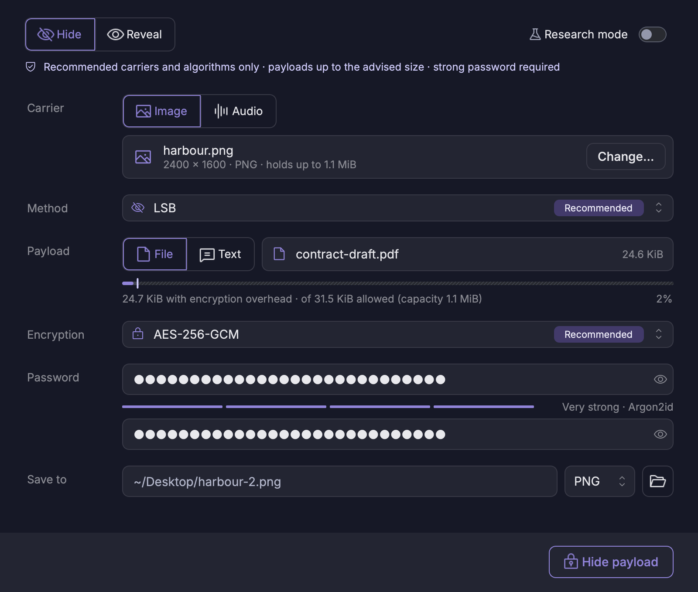
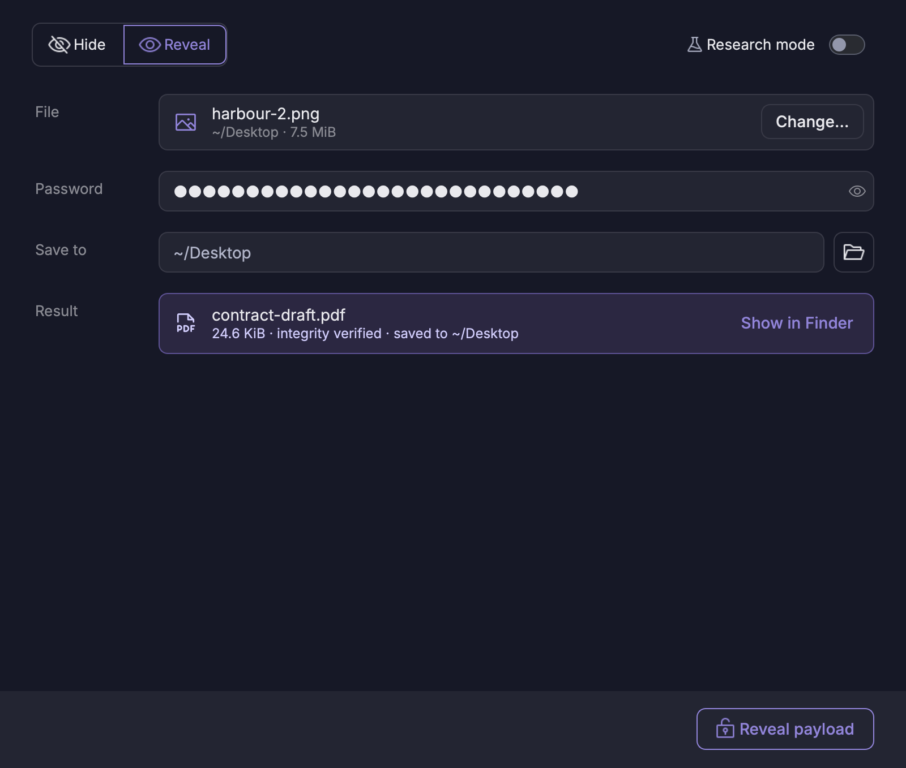
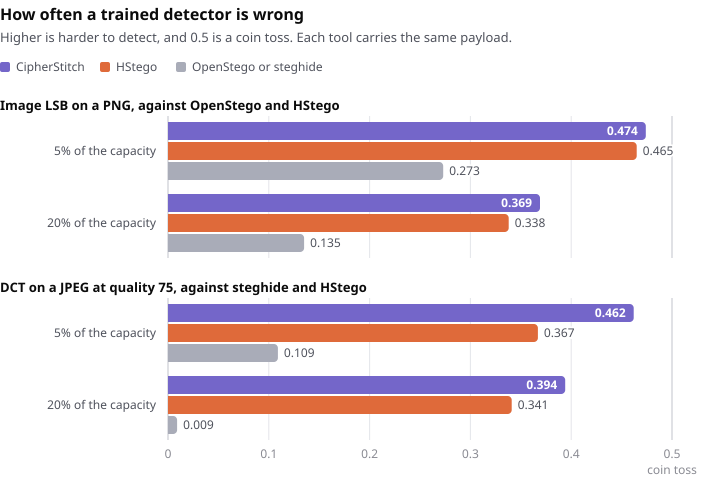

# CipherStitch

Hide any file inside an image, a recording, a document or a plain-text file, optionally
encrypted with a password. CipherStitch comes as a command-line tool, a desktop app and a
Python package.

CipherStitch is an educational project for research and teaching. Read
[Purpose and disclaimer](#purpose-and-disclaimer) before you use it.




## Features

CipherStitch has two modes. **Standard mode** is the default in the app, on the command
line and in the library. It offers only the recommended methods and ciphers, with their
tested defaults. **Research mode** is experimental. It opens every method, cipher and
parameter for studying them, and its output may be easier to detect, so it is not for real
secrets.

### Standard mode

- **Three recommended methods.** The two image methods were measured against trained
  detectors (see [How hard is it to detect](#how-hard-is-it-to-detect)), and audio LSB
  codes its samples as image LSB codes pixels.

  | Carrier | Formats                                                       | Method           |
  | ------- | ------------------------------------------------------------- | ---------------- |
  | Image   | PNG, BMP, TIFF (8-bit colour)                                 | LSB              |
  | Image   | JPEG, or a camera RAW, PNG or TIFF that it compresses to JPEG | DCT coefficients |
  | Audio   | WAV, FLAC (16- or 24-bit)                                     | Audio LSB        |

- **Always encrypted:** a key derived with Argon2id, then AES-256-GCM (default),
  ChaCha20-Poly1305 or XChaCha20-Poly1305, with a password that zxcvbn rates strong.
- **No readable marker:** a payload has no magic bytes or readable header, and its file
  name is encrypted with it. Revealing needs only the password, and "wrong password" looks
  exactly like "nothing hidden".
- **Harder to detect:** image and audio LSB move values by ±1 (LSB matching) over
  syndrome-trellis codes, weighed by HILL, so the changes go to busy areas and stay out of
  flat colour and digital silence. DCT hides in the JPEG's own coefficients with ±1
  changes over the same codes, weighed by J-UNIWARD, so they go to textured areas rather
  than smooth ones, and mostly towards an estimate of the picture before compression. From
  a camera RAW, PNG or TIFF it compresses the JPEG itself and moves nearly every changed
  coefficient towards the picture's own value. Both store the payload in each value's two
  lowest bits, so a step up and a step down both carry data and a payload takes fewer and
  cheaper changes. They spread the changes over the whole carrier, in a secret order.
- **Payloads up to the advised size,** and only covers that don't give the changes away:
  no JPEG cover for LSB, no picture or recording so flat or silent that the changes would
  land there (see [Standard and Research mode](docs/user-guide.md#standard-and-research-mode)).
  The app and `ciphst capacity` show the advised size for every carrier.
- **Safe file handling:** revealing never overwrites a file and refuses hidden file names
  that could point outside the chosen folder or start with a dot. Hiding writes its result
  atomically, so a cancelled or failed run leaves the destination as it was.
- **No traces:** the app saves no settings or history. It starts in Standard mode every
  time, and its file dialogs leave Qt's folder history as it was (see [What the app
  keeps](docs/security.md#what-the-app-keeps)).

### Research mode (experimental)

`--research` on the command line, the app's *Research mode* switch, or `research=True` in
the library. It offers Standard mode's methods too, and adds:

- **The other carriers and methods:**

  | Carrier  | Formats               | Methods                                         |
  | -------- | --------------------- | ----------------------------------------------- |
  | Audio    | WAV, FLAC             | phase coding, echo hiding                       |
  | Document | PDF, DOCX             | embedded object stream, DOCX whitespace padding |
  | Text     | TXT, Markdown (UTF-8) | zero-width characters                           |

- **More ciphers:** AES-256-CBC + HMAC-SHA256 and Fernet, or no encryption. Without a
  password the payload is only masked with a random nonce: generic tools see random bytes,
  but anyone who knows the format can read it.
- **Payloads up to the capacity,** and covers that Standard mode refuses, such as a nearly
  flat picture, with a warning. JPEG, WebP, greyscale and palette covers for LSB, and
  8-bit audio, are parameters that start off.
- **Parameters** that change how the methods work, such as the syndrome-trellis code's
  constraint height or the Argon2id costs, in the app's parameter editor. A `.csprofile`
  profile keeps them for `--profile` (see [Profiles](docs/user-guide.md#profiles)). Some
  change the stored format, so a payload hidden with them reveals only with the same
  profile.
- **Other cost functions:** WOW, S-UNIWARD and MiPOD beside HILL for image LSB, and UERD
  beside J-UNIWARD for DCT, to compare where each one puts the changes.
- **An Experimental baseline:** sequential LSB replacement, the classic method that WS, SPA
  and chi-square tests catch, as a reference point for detector tests. Only Research mode
  reveals it.
- **Extensions:** your own embedding methods, ciphers and cost functions, each a Python
  module dropped into `src/cipherstitch/extensions/`. Research mode lists them as
  Experimental and `ciphst extensions` shows what loaded. Standard mode never imports them
  (see [Extensions](docs/extensions.md)).

## Installation

Requires Python 3.12 or later. With [uv](https://docs.astral.sh/uv/), from a checkout:

```bash
git clone https://github.com/leo-scientist/cipherstitch.git
cd cipherstitch
uv tool install ".[gui]"                 # CLI and desktop app
uv tool install .                        # CLI only
uv tool install ".[gui,audio,documents]" # with optional extras, see below
make install-app                         # CLI and desktop app with every extra
```

Without uv, pip installs it straight from GitHub:

```bash
pip install "cipherstitch[gui] @ git+https://github.com/leo-scientist/cipherstitch"
```

| Extra          | Adds                                                     | Installs             |
| -------------- | -------------------------------------------------------- | -------------------- |
| `gui`          | the desktop app                                          | PySide6 Essentials   |
| `crypto-extra` | XChaCha20-Poly1305                                       | PyNaCl               |
| `audio`        | FLAC carriers                                            | soundfile            |
| `documents`    | PDF carriers and DOCX whitespace padding (Research mode) | pikepdf, python-docx |
| `jpeg`         | the JPEG DCT method                                      | jpeglib              |
| `raw`          | camera RAW carriers for DCT                              | rawpy                |
| `ecc`          | phase coding, echo hiding (Research)                     | reedsolo             |

Everything else works without extras.

Platform notes: jpeglib has no Linux aarch64 wheel, so the `jpeg` extra builds it from
source there, which needs a C compiler. pikepdf's macOS arm64 wheels need macOS 15 or
later.

## Quick start

```bash
ciphst capacity cover.png                        # bytes a payload may take, in each mode
ciphst hide cover.png report.pdf -o cover-2.png  # encrypts, asks for a strong password
ciphst reveal cover-2.png -d ./out -e            # -e: ask for the password
ciphst-gui                                       # the desktop app
```

From a checkout, `make run` starts the desktop app without installing it, and `make help`
lists the other commands.

Choose the method and the cipher explicitly with `--method` and `--cipher`:

```bash
ciphst hide song.wav key.txt -o song-2.wav --method audio-lsb --cipher chacha20-poly1305
```

Research mode takes every other method and cipher, and a profile of parameters:

```bash
ciphst hide song.wav key.txt -o song-3.wav --research -e --method echo-hiding
ciphst hide notes.md key.txt -o notes-2.md --research --cipher none
ciphst hide photo.png key.txt -o photo-2.png --profile fast-stc.csprofile
ciphst reveal photo-2.png -d ./out -e --profile fast-stc.csprofile
```

As a library:

```python
from pathlib import Path

from cipherstitch import hide_file, reveal_file

password = "quiet harbour 47 lanterns"
hide_file(Path("cover.png"), Path("report.pdf"), Path("cover-2.png"), password=password)
reveal_file(Path("cover-2.png"), Path("out"), password=password)
```

## How hard is it to detect

**In our measurements, CipherStitch's payloads were far harder to detect than those of
popular tools such as OpenStego and steghide, and harder than HStego's, at the same size.**

<picture>
  <source media="(prefers-color-scheme: dark)" srcset="assets/charts/detectability-dark.svg">
  
</picture>

We measured it on 3,000 photos per method from the [ALASKA v2](https://alaska.utt.fr/)
dataset (512 × 512 pixels), against a detector trained on CipherStitch's own output, which
knows everything but the password ([full study](docs/detectability.md)). The table gives
its error rate: 0.5 is a coin toss, 0 means it is never wrong. The tools measured are
OpenStego 0.8.6, steghide 0.5.1 and HStego 0.6.1.

| Method, cover, payload                | CipherStitch | HStego    | Popular tool, same payload |
| ------------------------------------- | ------------ | --------- | -------------------------- |
| Image LSB, PNG, 5% of the capacity    | **0.474**    | 0.465     | 0.273 (OpenStego)          |
| Image LSB, PNG, 20% of the capacity   | **0.369**    | 0.338     | 0.135 (OpenStego)          |
| DCT, JPEG at quality 75, 5%           | **0.462**    | 0.367     | 0.109 (steghide)           |
| DCT, JPEG at quality 75, 20%          | **0.394**    | 0.341     | 0.009 (steghide)           |

Popular tools such as zsteg, StegExpose, binwalk and stegdetect look for the traces of LSB
replacement, text in bit planes, file signatures or other tools' formats. CipherStitch
leaves none of these, so they flag its files no more often than untouched photos. HStego,
which also places its changes by content-adaptive costs, comes closest. CipherStitch is
harder to detect at both sizes, though only just for image LSB at 5%. Storing the payload
in each value's two lowest bits, and in a JPEG moving most coefficients towards an
estimate of the picture before compression, took the previous version's 0.467 and 0.327
for image LSB and 0.442 and 0.242 for DCT to the numbers above. The released HStego
refuses payloads above 5% of its own capacity, so it ran without that limit here. The
trained detector does find large payloads, so keep them small. The app advises a size for
each carrier, where this detector is wrong at least 45% of the time: about 11% of a 512 ×
512 PNG's capacity and 7% of a JPEG's, and less in a larger picture (see [Staying
inconspicuous](docs/security.md#staying-inconspicuous)). Each payload above is the bytes
the first version hid at that share of its capacity, about 6% and 25% of image LSB's
present one. Hiding while compressing a camera RAW, PNG or TIFF to JPEG did best of all:
0.493 at 5% and 0.459 at 20% from a TIFF. Every number here is for Standard mode's methods
at their defaults.

## Limitations

- **Hidden is not invisible.** Steganalysis can detect image and audio embedding, and
  Research mode's document and text methods are visible to anyone who inspects the file
  closely.
  Encryption protects *what* is hidden. It does not hide the fact *that* something is
  hidden (see [Staying inconspicuous](docs/security.md#staying-inconspicuous)).
- **Lossy processing destroys the payload.** Re-compressing an image, converting audio to
  MP3, AAC or Ogg, or opening a text in an editor that strips zero-width characters is
  enough to lose it.
- **Research mode is not measured** beyond Standard mode's methods at their defaults.
  Its other methods, and any changed parameter, may be much easier to detect.

## Documentation

- [User guide](docs/user-guide.md): the CLI reference, the desktop app, Standard and
  Research mode, the Python API and troubleshooting
- [Embedding methods](docs/methods.md): how each method works, its capacity and limits
- [Security model](docs/security.md): what is protected, what is not, and how to stay
  inconspicuous
- [Detectability](docs/detectability.md): how hard CipherStitch's payloads are to detect,
  measured
- [Architecture](docs/architecture.md): modules, data flow, extending CipherStitch
- [Extensions](docs/extensions.md): writing, testing and loading your own methods, ciphers
  and cost functions for Research mode
- [Stored format](docs/format.md): the byte-level specification
- [Contributing](CONTRIBUTING.md): development setup, checks and conventions

## Purpose and disclaimer

CipherStitch is an educational project. Its purpose is scientific and educational: it
shows how steganography, steganalysis and authenticated encryption work in practice, and
publishes its methods, its stored format and its measurements in full. It is not a
commercial product, and neither its code nor its cryptography has been audited
independently.

- **No warranty.** CipherStitch is provided "as is", without warranty of any kind, under
  the [MIT License](LICENSE). Hidden data can be detected or lost, and a forgotten
  password cannot be recovered. Don't rely on it where detection or a lost file would put
  you or anyone else at risk.
- **No liability.** The author is not responsible for how CipherStitch is used, and
  accepts no liability for any damage, loss of data or legal consequences of its use.
- **Lawful use.** You alone are responsible for using it lawfully. Laws on encryption and
  on hiding data differ from country to country. Don't use CipherStitch to break the law,
  to hide illegal content or to harm others, and hide data only in files you have the
  right to use.

## License

[MIT](LICENSE) © 2026 Yurii Kit

This software is based in part on the work of the Independent JPEG Group: the JPEG
compression in `src/cipherstitch/media/precover.py` is a translation of its integer
arithmetic. Bundled assets: [Inter](https://rsms.me/inter/) (SIL OFL 1.1) and
[Phosphor icons](https://phosphoricons.com) (MIT). Their licenses are next to the files in
`src/cipherstitch/gui/resources/`. [Third-party notices](THIRD_PARTY_NOTICES.md) has the
full terms, the dataset of the detectability study and the licenses of the dependencies.
The app icon is in `src/cipherstitch/gui/resources/app-icon/` (16–512 px), and
`assets/icon/` holds the `.icns`, `.ico`, SVG and 1024 px sources for app bundles.
