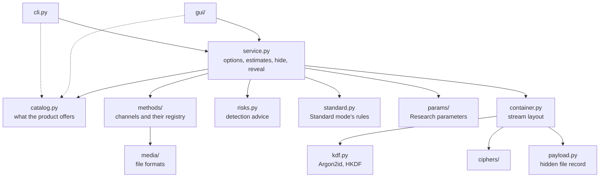
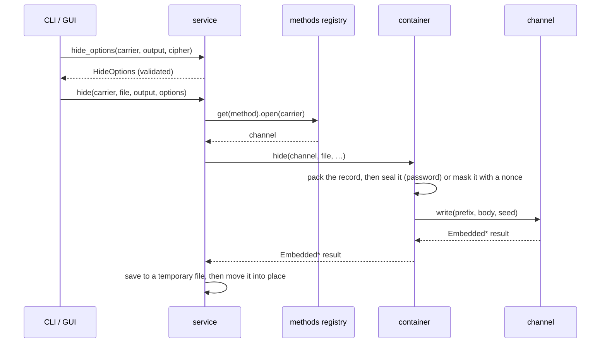

# Architecture

CipherStitch is a library with two front ends. The CLI and the desktop app run every
operation through `cipherstitch.service` and read `catalog` for what to display.
Everything below the service is independent of the user interface.



## Modules

| Module                      | Responsibility                                                              |
| --------------------------- | --------------------------------------------------------------------------- |
| `catalog.py`                | carriers, methods and ciphers: names, tiers, pros and cons, optional extras |
| `service.py`                | the API of the front ends: validation, estimates, step labels, hide, reveal |
| `risks.py`                  | what makes a payload easier to detect: advice that never blocks hiding      |
| `availability.py`           | why an option cannot run in a mode, and the default method for a carrier    |
| `offers.py`                 | what each mode lists: carriers, methods, ciphers, suffixes, extensions      |
| `standard.py`               | Standard mode's rules, and the cover rules Research keeps as parameters     |
| `params/`                   | Research's parameters, `engine`, which makes them what methods read, and `profile` (`.csprofile` files) |
| `password.py`               | the password strength the meter shows and the modes require                 |
| `container.py`              | the stream layout, the `Channel` protocol and trial reveal                  |
| `kdf.py`                    | the master key (Argon2id, or Research's scrypt or PBKDF2) and HKDF subkeys  |
| `ciphers/`                  | one module per cipher, looked up with `ciphers.get(id)`                     |
| `payload.py`                | the hidden file record and file-name safety                                 |
| `sizes.py`                  | sizes as the app and the advice show them                                   |
| `methods/`                  | one channel per embedding method, and the registry in `__init__.py`         |
| `extensions/`               | Research mode's drop-in methods, ciphers and cost functions, and their contract ([Extensions](#extensions)) |
| `extension_loader.py`       | finds, checks and builds the extensions, once per process                   |
| `extension_checks.py`       | the rules an extension must follow to load, and the cipher self-test        |
| `extension_guards.py`       | the guards around every call into an extension                              |
| `extension_testing.py`      | `check_method`, `check_cipher` and `check_cost`, for an extension's own tests |
| `media/`                    | reading, describing and writing each carrier format                         |
| `errors.py`                 | the exception hierarchy                                                     |
| `cli.py`                    | the `ciphst` command                                                        |
| `gui/`                      | the PySide6 desktop app                                                     |

## Hiding



1. `service.hide_options` (or `unavailable_reason`) validates the carrier, method,
   cipher and output format before any work, so the CLI fails before asking for a
   password.
2. `methods.get(method).open(carrier)` opens the carrier as a **channel**. Image and
   audio LSB channels read only the header here. Pixels and samples are decoded on first
   use.
3. `container.hide` packs the record. With a password, it derives the keys and seals the
   header and the record. Without one, it masks the plain frame with a fresh 16-byte
   nonce. Then it calls `channel.write(prefix, body, seed)`, where the prefix is the salt
   or the nonce.
4. The channel returns an `Embedded*` object (`EmbeddedImage`, `EmbeddedAudio`, …) whose
   `save(path)` writes the result. `service._save` saves it to a hidden temporary file
   and `Path.replace`s it into place.

## Revealing

1. `methods.for_reveal(path)` lists the methods that can have written a file with this
   suffix, grouped by channel type.
2. `service._open_groups` opens one channel per group. A channel that needs a missing
   extra (`NotAvailableError`) or cannot read this file (`UnsupportedFormatError`) is
   skipped, as long as another one can. When the reveal then finds nothing, its error ends
   with the install hints of the channels skipped for a missing extra.
3. `container.reveal` tries the plain frame in every group first.
4. With a password, it then costs one Argon2id run per group that has room for a salt,
   and tries every candidate order and installed cipher on the sealed header.

That is Standard mode's reveal, at the default parameters. It leaves out the Experimental
methods and the sequential order (`standard.reveals`), which only Research mode hides
with. Research mode's (`service.ResearchReveal`) opens only its method's channel with its
parameters, and `container.reveal` tries only its cipher, or only the plain frame for
`none`. It tries every order whatever `frame.order` says. Every failure to find a payload
is the same `NoHiddenDataError`.

The full procedure is in [Stored format](format.md#revealing).

## Channels

A channel is a carrier opened for one embedding method. It implements the protocol in
`container.py`:

```python
class Channel[Output](Protocol):
    def capacity(self, prefix_size: int) -> int: ...
    def stored_limit(self, prefix_size: int) -> int: ...
    def read(self, prefix_size: int, size: int, seed: bytes | None) -> bytes: ...
    def write(self, prefix: bytes, body: bytes, seed: bytes | None) -> Output: ...
```

- `capacity` is the number of body bytes that fit after a prefix.
- `stored_limit` is the most body bytes a write can have stored after a prefix. Reveal
  checks stored lengths against it, because embedding may lower `capacity` (DCT turns
  some coefficients into zeros, LSB makes some values flat or moves them to an end of the
  range). The object and whitespace channels read up to the highest limit a write may be
  given (`object_stream.MAX_LIMIT`, `whitespace.MAX_BITS_PER_PARAGRAPH`), so a payload
  hidden with a larger limit still reveals. For the other channels it equals `capacity`.
- `read` returns body bytes in the channel's own order, in the keyed order of `seed`, or in
  sequence for `SEQUENTIAL_SEED`, which Research's sequential order passes.
- `write` returns the carrier with the prefix and the body stored, or raises
  `CapacityError`.

Three base classes implement it:

- **`SlotChannel`** (`methods/slots.py`) for carriers made of fixed-width units: the
  insertion points of zero-width text, and the colour values that sequential LSB
  replacement overwrites (`methods/lsb_replacement.py`). A subclass only reads and writes
  the bits of given units. The keyed order is the Feistel permutation of `methods/feistel.py`.
- **`TrellisChannel`** (`methods/trellis.py`) for carriers of integer values whose two
  lowest bits hold the data as the syndrome of syndrome-trellis codes in both bit planes,
  or in the parities alone with Research's binary coding. Its lead holds the prefix. Each
  body stream lives in its own order and is read head first, so header reads never decode
  a whole carrier. With two planes, the head records how the tail's bits are shared
  between them, and writing codes the second bits first, then the parities. Binary coding
  runs one search over the parities. A subclass gives the values, their range, what a step
  of each one costs, and which of them the capacity counts. A step up and a step down may
  cost different amounts. Costs may depend on the payload, so the subclass learns how many
  message bits per unit the codes store. Writing checks that the stepped values spell the
  data before it builds the result. Every write codes the lead and a head, so the capacity
  is 0 when their values can't take every message: a value at an end of the range can't
  flip its second bit, and a white band can leave a code's rows out of reach.
- **`StreamChannel`** (`methods/stream.py`) for carriers that store one byte stream: a
  PDF or DOCX object, DOCX whitespace or Reed–Solomon-coded audio. A subclass only reads
  and writes the stream.

`EccAudioChannel` (`methods/ecc.py`) builds on `StreamChannel` for phase coding and echo
hiding. It frames the stream in Reed–Solomon codewords, decodes codeword by codeword, and
reads the result back after embedding.

Two channels build on `TrellisChannel`:

- `DctChannel` (`methods/dct.py`) changes the AC coefficients of a JPEG by ±1 at their
  J-UNIWARD cost, less towards an estimate of the picture. A RAW, PNG or TIFF is first
  compressed to JPEG coefficients by `media/precover.py` (a RAW developed by
  `media/raw.py`), which keeps each coefficient's rounding error: it lowers the cost of a
  step towards the picture and raises the other.
- `LsbChannel` (`methods/lsb.py`) changes the colour values of an image or the samples of
  a recording by ±1 at their HILL cost. Flat values, in runs of 16 or more equal ones, get
  a cost so high that the code changes one only in a block with nothing else. The channel
  also measures how much of the carrier is flat (`flat_share`), and `flat_blocks`
  estimates how many such blocks a payload meets.

Four numpy-only modules support them:

- `methods/stc.py` holds the syndrome-trellis codes, a Viterbi search over many segments
  in lockstep.
- `methods/juniward.py` gives each coefficient its J-UNIWARD cost. It decompresses each
  component strip by strip and filters it with three wavelet filters. For a precover it
  tilts each cost by the rounding error into the costs of a step up and a step down. For a
  JPEG it estimates which way the picture lies, with a 3 × 3 Wiener filter, and makes the
  step that way cheaper. In Research mode, DCT can take UERD costs instead
  (`methods/uerd.py`), from each block's energy and its neighbours' and the quantization
  steps. Both tilts apply to them too.
- `methods/hill.py` gives each colour value or sample its HILL cost, stretch by stretch.
  In Research mode, image LSB can take WOW or S-UNIWARD costs instead
  (`methods/spatial_costs.py`), from the Daubechies 8 filters J-UNIWARD uses
  (`methods/wavelet.py`). It can also take MiPOD costs (`methods/mipod.py`), from a
  variance estimated around each value and the payload's size.
- `methods/feistel.py` holds the keyed order, which every keyed channel shares, and the
  golden-ratio multiplier that numbers the trellis units. The order is evaluated at any
  positions, so no whole order is ever stored.

The `Embedded*` results keep what they can of the cover when they are saved. A JPEG is
written with the cover's kind of Huffman tables, and `media/jpeg_header.py` then gives
libjpeg's output the cover's APPn and COM segments and component ids back. A precover's
JPEG gets component ids 1 to 3 and an RGB ICC profile, if the picture has one. An image keeps
its `media.image.Metadata` (RGB profile, EXIF, XMP, resolution, PNG chunks, TIFF tags and
lossless TIFF compression). Pillow cannot write Exif and GPS sections into a compressed
TIFF, so `media/tiff_directory.py` writes its directory again with them. A DOCX package
keeps its entries' dates and compression. Whitespace padding writes only the main document
anew and copies the cover's other entries as they are, except the printer settings it
removes with their links and the custom property a metadata write stored.

## The method registry

`methods/__init__.py` registers each implemented method as an `Embedding`:

| Field     | Meaning                                                               |
| --------- | --------------------------------------------------------------------- |
| `method`  | the catalog's `MethodId`                                              |
| `order`   | `SEQUENTIAL` or `KEYED_IF_ENCRYPTED`                                  |
| `open`    | the channel class (or factory) that opens a carrier                   |
| `inputs`  | carrier suffixes the method can hide in                               |
| `outputs` | suffixes it writes, or `None` to keep the carrier's format            |

`KEYED_IF_ENCRYPTED` methods use the keyed order when the payload is encrypted, and their
channel's own order otherwise. Research's `frame.order` can put an encrypted body in the
public order or in sequence instead.

## Catalog and service

`catalog.py` describes what the product offers, independently of the implementation:
carrier types and their extensions, methods and ciphers with their tiers, pros and cons,
and the optional extra (`Requirement`) each one needs. The app's pickers and the
service's validation both read it.

`service.py` is the only API the front ends use:

- `unavailable_reason` and `hide_options` validate options before any work, with the
  reasons and the default method from `availability.py`.
- `describe_carrier` and `estimate` feed the capacity meter. They are cached on the
  carrier's mtime and size, because the app estimates on every keystroke.
- `detection_risks` and `is_conspicuous` say what makes the payload easier to detect
  (`risks.py`), as advice that never blocks hiding. `Estimate.advised` is the most a
  payload should take: `risks.ROOT_RATES` bits per square root of the values the
  statistical channel counts (`element_count`), or `risks.PRECOVER_ROOT_RATE` for DCT from
  a RAW, PNG or TIFF, and below the calibrated size the share of the capacity it has at
  that size. Flat colour and digital silence need
  the decoded carrier, so `risks.flat_cover` caches its finding on the file's mtime and
  size.
- `HideOptions` default to Standard mode (`standard.py`): the same functions then name
  what it turns off, `unavailable_carriers` lists the carrier types it turns off,
  `Estimate.limit` is its capacity limit, and `hide` enforces every rule. Standard mode
  ignores `HideOptions.settings`. With `is_research`, the settings apply, and only their
  cover rules (`limg.lossy`, `laud.depth`) and password minimum (`crypto.minpw`) remain.
  `mode_carriers`, `mode_methods` and `mode_ciphers` list what each mode offers, and
  Research mode's lists end with the [extensions'](#extensions) entries.
- `hide_step_labels` and `reveal_step_labels` name the progress steps. Research mode's
  reveal names its method and cipher.
- `reveal_methods` lists the methods that can have hidden a payload in a file's type, for
  Research mode's Reveal. `carrier_for_path`, `carrier_suffixes` and `reveal_suffixes` give
  the carrier type of a file and the suffixes the file dialogs offer, by mode.
- `loaded_extensions` and `extension_failures` report what Research mode loaded.
- The mode lists above (`mode_*`, `unavailable_carriers`, `unavailable_methods`,
  `unavailable_ciphers`, `output_suffixes`, `carrier_for_path`, `carrier_suffixes`,
  `reveal_methods`, `reveal_suffixes` and the two extension reports) live in `offers.py`,
  and the service re-exports them, so the front ends still call `service`.
- `hide` and `reveal` do the work.

### Progress and cancellation

`hide` and `reveal` take a `ProgressCallback(index, count, label)`. It is called before
each step, and once more with the last step just before the result is moved into place.
It may raise `OperationCancelledError`, and then nothing is written.

## Optional dependencies

The core needs only cryptography, numpy, Pillow and zxcvbn (the password strength
estimate). Optional libraries are imported lazily inside functions. A missing one raises
`NotAvailableError` with an install hint from the catalog's `Requirement`, for example
`FLAC needs the audio extra, see Installation in README.md`.

| Extra          | Library            | Enables                                     |
| -------------- | ------------------ | ------------------------------------------- |
| `gui`          | PySide6 Essentials | the desktop app                             |
| `crypto-extra` | PyNaCl             | XChaCha20-Poly1305                          |
| `audio`        | soundfile          | FLAC carriers                               |
| `documents`    | pikepdf, python-docx | PDF carriers, DOCX whitespace padding     |
| `jpeg`         | jpeglib            | DCT coefficients                            |
| `raw`          | rawpy              | camera RAW carriers for DCT                 |
| `ecc`          | reedsolo           | phase coding, echo hiding                   |

## Errors

Every error derives from `CipherStitchError`:

| Error                     | Raised when                                                      |
| ------------------------- | ---------------------------------------------------------------- |
| `CapacityError`           | the payload does not fit, exceeds the advised size in Standard mode, or cannot be embedded reliably |
| `NoHiddenDataError`       | nothing is hidden, the password is wrong, or Research mode's method, cipher or parameters are not the ones used (deliberately the same) |
| `UnsupportedFormatError`  | the carrier or output format is not supported, or the file is malformed |
| `InvalidFileNameError`    | a hidden file name is empty, too long or unsafe                  |
| `NotAvailableError`       | the chosen options cannot run: a missing extra, a combination that cannot work (e.g. a method that cannot use the carrier's format), or an option the mode turns off |
| `OperationCancelledError` | the progress callback cancelled the operation                    |
| `DecryptionError`         | a sealed block failed authentication (internal to reveal)        |
| `ExtensionError`          | an extension's code raised another exception or broke the contract |

## Desktop app

- `gui/app.py` creates the application, and `theme.py` loads the Inter font, the
  stylesheet `resources/cipherstitch.qss`, the app icon and the Phosphor icons.
- `MainWindow` switches between the Hide and Reveal pages and shows the drag-and-drop
  overlay. It raises its minimum height to the form's on every layout request, so rows
  are never squeezed. It also holds the *Research mode* switch (on both pages), off at
  every launch, which calls each page's `set_research`. The Hide page offers only the
  mode's carriers, methods and ciphers (`service.mode_*`), and in
  Research mode shows the Parameters row (`widgets/parameters.py`) for `registry.groups_for`
  the chosen method. In Research mode the Reveal page asks for the method
  (`service.reveal_methods`), the cipher and the parameters, which make its
  `service.ResearchReveal`. Each page's *Edit…* opens
  `widgets/parameter_editor.ParameterEditor` on the page's `parameter_scope()`, a sheet
  over the window built from the registry alone (one `widgets/parameter_rows.ParamRow` per
  parameter, controls by type). Closing it hands the settings to that page's
  `set_settings`: each page keeps its own. A value `Settings` refuses never gets in.
- Profiles: the Parameters row's *Load profile…* reads one through `gui/profiles.py`
  (file dialogs and the eight used lately, kept for the session) and emits it for its page
  to apply. The editor's *Export…* writes one, and its menu offers the ones used lately.
  `app.run` opens a profile given on the command line through `MainWindow.open_profile`.
  So does a `QFileOpenEvent`, for when a packaged app registers the file type.
- The app stores no settings. Every file dialog goes through `gui/file_dialogs.py`, which
  puts the `FileDialog` group of Qt's shared `QtProject` settings back as it was, since a
  closing Qt dialog records its folders there (see
  [What the app keeps](security.md#what-the-app-keeps)).
- Each page in `pages/` is an `OperationPage`: a form and a footer. It runs one service
  call at a time as a `worker.BackgroundTask` on Qt's thread pool.
- The Encryption and Method fields share `widgets/picker.py` (`PickerField` and
  `PickerPopover`), fed by the catalog's `Cipher` and `Method` entries.
- Extensions show in Research mode only. The pickers and the Reveal page's lists come from
  the service's mode lists, so an extension's entries follow the built-ins. The picker's
  detail panel ends with "From the extension x" (`Option.extension`), and every option text
  is plain text, never markup. Carrier files go through `service.carrier_for_path`, and the
  file dialogs and the drop overlay take `service.carrier_suffixes` on Hide and
  `service.reveal_suffixes` on Reveal, all by mode. `main_window.failure_lines` gives one
  line per load failure (`service.extension_failures`, `Failure.brief`) for a `WarningList`
  under the Research note, and prints every problem and the traceback on stderr once per
  process. `pages.base.print_cause` prints an `ExtensionError`'s cause on stderr when an
  operation fails or a carrier can't be described. The extensions load on the UI thread,
  the first time Research mode is on.

**Cancel** returns to the form at once. The task's progress callback raises
`OperationCancelledError` at the next step, so the job stops without writing anything.
`BackgroundTask` drops a cancelled job's result or error and always emits `finished`
last. `OperationPage` keeps abandoned tasks alive by id until they finish and ignores
their signals.

The source of truth for styles is `cipherstitch.qss`.

## Extensions

Research mode can run methods, ciphers and cost functions from outside the core. Each one
is a module or a package in `src/cipherstitch/extensions/` that exports `EXTENSION`, an
`Extension` of `MethodSpec` and `CipherSpec` entries, the methods' parameter groups and
`CostSpec` cost functions for image LSB and DCT. The folder's `__init__.py` holds that
contract and re-exports what an extension builds on. It ships with nothing else:
`.gitignore` leaves every other file in the folder out, so a local extension is never
committed or packaged.

### Loading

`extension_loader.load()` runs once per process, the first time Research mode needs the
extensions: for its lists, for `ciphst extensions`, or to look up an id that isn't a
built-in's.

1. It imports every module and package in the folder whose name doesn't start with `_`,
   sorted by name. Any exception fails that module and keeps its traceback, and so does
   `SystemExit` (an argument parser run at import). Ctrl+C stops the load.
2. `EXTENSION` must be an `Extension`, and its entries must follow the rules of
   `extension_checks.py` below. One broken rule fails the whole module, and the failure
   lists every problem.
3. Modules that claim the same id, wire id, parameter group id or cost function id (within
   its domain), or the same new suffix for different carrier kinds, all fail.
4. Each entry becomes the same `catalog.Method` or `catalog.Cipher` and `methods.Embedding`
   a built-in has, with the Experimental tier and the extension's name in `extension`. The
   result keeps the extensions in name order and their entries in the order they are
   declared, and lists the failures.

| Rule              | What it asks                                                              |
| ----------------- | ------------------------------------------------------------------------- |
| ids               | lower-case letters and digits in words joined by hyphens, at most 32 characters, unique, and not a built-in's id, `none` or `order` |
| wire ids          | an `int` in 128–254, unique among the methods and among the ciphers ([Ids](format.md#ids)) |
| texts             | a name of 1–40 characters with something visible in it, an optional text that is empty or has something visible, and no control or format character in any text the app shows (`hidden_text.HIDDEN`, the fixed Cc/Cf table that profiles check their name and note with) |
| carrier, suffixes | a `CarrierKind` and suffixes such as `.txt`. A built-in suffix belongs to its own kind, and a new one joins the method's |
| outputs           | `None` or a non-empty tuple of suffixes                                   |
| order, open       | an `Order`, and a callable                                                |
| requires          | a `Requirement` that names a top-level module in ASCII letters, digits and underscores (`[A-Za-z_][A-Za-z0-9_]*`, since `str.isidentifier` takes format characters). Without that module the entry loads, unavailable, with an install hint |
| ciphers           | a key of 16–64 bytes and a self-test: exact sizes that never decrease, round trips, a flipped bit, a wrong key and a cut block refused with `DecryptionError` alone, no plaintext in the output, and no output shared between counters 0 and 1 (the header and the record share a key) |
| parameters        | `Group` and `Param` entries whose ids profiles can store (`[a-z][a-z0-9]{0,31}`, no built-in group's id), labels and texts as above, one of the app's icons, scopes that name only the extension's own methods (a group's names one or more), choices whose options hold an `int`, `float` or `str` (never a `bool`), numbers the editor's spin boxes can hold (whole `INT` bounds and step within Qt's 32-bit int, a `FLOAT` step of at most 15 decimals, `params.values.decimals`), defaults the settings allow in their canonical type and on a step from the minimum, and a check that is `None` or callable and accepts the defaults |
| cost functions    | ids as above, unique within their `Domain` and none of the built-in options of its parameter (`limg.cost` or `dct.cost`), a label of 1–40 characters with something visible in it, a `Domain`, and a callable |

An extension's `Requirement` can name a pip package instead of an extra. Its hint then
reads `Line-end spaces needs scipy: pip install scipy`.

### Lookups

`catalog.method` and `catalog.cipher`, `methods.get`, `ciphers.get` and the container's
`method_wire_id`, `cipher_wire_id` and `cipher_key_info` look in the built-ins first. Only
an id they don't know loads the extensions. An extension cipher's key comes from its wire
id ([Keys](format.md#keys)). `methods.for_reveal` adds an extension's method only when a
Research reveal names it. `ciphers.encrypting()`, the ciphers Standard's reveal tries,
lists built-ins only.

### Parameters

`params.registry` holds the built-in groups (`BUILTIN_GROUPS`, `BUILTIN_PARAMS`), then the
loaded extensions' (`groups()`, `extension_groups()`). `lookup` and `knows` look in the
built-ins first, and only a key in a group no built-in has loads the extensions: no
extension's group takes a built-in id, so a built-in group's key they don't have (a newer
version's) is unknown without a load. `groups_for` loads
them only for a method that isn't a built-in's, or to list the cost functions of LSB's
and DCT's groups ([Cost functions](#cost-functions)). So settings, the editor, presets and
profiles take an extension's keys like any other, and Standard mode, which reads no
settings, never builds that part of the index.

A built-in scope can reach an extension's method through a `Trait`: the STC group and
`frame.rounds` (`coding.TRELLIS`) apply to a method with `MethodSpec.codes_with_trellis`,
which reads `tuning.coding`, and `frame.order` to an `Order.KEYED_IF_ENCRYPTED` method.
`groups_for` takes the traits from the loaded method.

`methods.Tuning.extension_values` carries the values to the opener, which reads them with
`Tuning.extension_value(key)`. `engine.tuning(settings, method)` fills it with every
parameter of `method`'s extension, its default included, and leaves it empty for a
built-in method, so Standard's tuning stays `methods.STANDARD` and the engine still never
imports `params`. The service passes the method wherever it opens a channel, and its
capacity cache keys on the tuning, values included. The loader wraps a group's `check` so
that an exception, or a result that isn't text, becomes the problem the settings report.

A profile key no loaded extension has goes to `Profile.unknown`, as a newer version's does.
When its group isn't a built-in's, the warning and the refusal add that an extension may be
missing.

### Cost functions

An extension's `CostSpec` adds an experimental option to `limg.cost` (`Domain.SPATIAL`) or
`dct.cost` (`Domain.JPEG`), `registry.COST_KEYS`. The registry reads the options afresh from
the loaded extensions at each call, so a loader reset leaves none behind:
`registry.param_for(name, value)`, which `settings.checked` uses, adds them only for a value
that isn't a built-in option, and `groups_for` adds them to the editor's LSB and DCT groups.
Standard mode reads no settings, and the Reveal page shows no parameter summary in Standard
mode, so neither loads the extensions. A profile keeps a cost function nobody has
(`registry.is_unknown_cost`) apart in `Profile.missing_costs`, out of its settings.
`profile.refuse_missing_costs` refuses it on the hide paths (the CLI's hide, the Hide page's
*Load profile…*) with the "(an extension that isn't installed?)" wording, since hiding would
otherwise go on with other costs. A reveal ignores it: it reads the same values whatever
the costs were. The editor doesn't offer such a profile by name.

`engine.tuning` keeps a built-in value as its `CostFunction` member and an extension's as
its id, so `ImageRules.costs` and `DctRules.costs` are `CostFunction | str` and Standard's
tuning is still `methods.STANDARD`. `ImageChannel._value_costs` and `DctChannel._costs`
route by value: a built-in's value, as a member or as text, goes to its own case of the
`match`, `assert_never` included, and any other to `extension_loader.spatial_costs` or
`jpeg_costs`, which find the loaded cost function (`NotAvailableError` if none) and call it
through `extension_guards.GuardedCosts`. The core keeps the rest: wet flat values, the
range, polarization, side information and the codes.
`risks._avoids_flat` treats an extension's cost function like the built-ins other than HILL,
so turning `limg.wet` off brings the flat-colour warning.

### Standard mode never loads them

Standard mode asks `catalog.is_builtin_method` and `is_builtin_cipher` before any lookup
and refuses any other id with "Unknown method x. Extension methods run only in Research
mode". Its hide, reveal, capacity and estimate never import an extension, so a slow or
broken one can't touch it and its output can't change. `tests/test_extension_isolation.py`
runs them with a loader that fails, along with the service's lists in Standard mode and the
CLI without `--research`. `tests/test_gui_extensions.py` does the same for a Standard
window, from its dialogs to a hide and a reveal.

| Where                                         | Standard                                 | Research                                    |
| --------------------------------------------- | ---------------------------------------- | ------------------------------------------- |
| `mode_methods`, `mode_ciphers`, `unavailable_methods`, `unavailable_ciphers` | the built-ins, no load | the built-ins, then the extensions' entries |
| `carrier_for_path`, `carrier_suffixes`        | the built-in suffixes                    | plus the new suffixes the extensions' methods hide in |
| `reveal_methods`, `reveal_suffixes`           | the built-ins                            | plus the extensions'                        |
| `describe_carrier`, `output_suffixes`         | an extension's id is unknown             | the extension's method, and a size-based description for a suffix no built-in reader knows |
| the default method                            | the built-ins                            | a built-in whenever one can hide in the file, an extension's only for a file no built-in method can use |
| `detection_risks`                             | as before                                | an extension's method adds its `risk`, or `risks.EXTENSION_RISK` |
| parameters                                    | no settings, the built-in groups only    | the extension groups of the method, keys in settings and profiles, and the loaded cost functions as options of `limg.cost` and `dct.cost` |
| a reveal                                      | built-in methods and ciphers only        | the named method and cipher only. An unknown id, or a missing requirement, is refused before anything is read |
| CLI `--method`, `--cipher`                    | built-in ids, any other refused with the line above and `(--research)` | built-in and extension ids, an unknown one names the choices |

The CLI's hint that Research mode would allow a refused hide tries Research's defaults
without loading: the default method falls back to an extension only when no built-in can
use the file, and that never happens for a built-in suffix.

### Guards

`extension_guards.py` wraps every opener, channel, embedded result, cipher and cost
function the loader builds. A `CipherStitchError`, a `MemoryError` or any `BaseException`
passes through. Any other exception becomes `ExtensionError` ("The extension x failed:
TypeError: …") with the original as its cause, and so does a result that breaks the
contract: a size that isn't an `int` of 0 or more, a stored limit below the capacity, a
read longer than asked, a `save` that leaves no file at its path, a sealed block of another
length than `sealed_size`, an `unseal`
that raises anything but `DecryptionError`, and costs that aren't a float32 or float64
array of the values' shape or that hold NaN or a negative value. A cost function gets
read-only views of the values, and its costs above the wet cost of 10¹⁰ (`lsb.WET_COST`,
`uerd.WET`), infinity included, become that cost, as the built-in ones never pass it. The
channel gets them as a fresh float32 array. The guards can't stop code that hangs, runs out
of memory or crashes the interpreter.

### Front ends and tests

- `ciphst extensions` lists what loaded and what failed, with every problem and the
  traceback, and exits with 1 if anything failed. A Research hide or reveal warns once per
  failure. An `ExtensionError` prints `error: …` and then its cause's traceback, for the
  extension's author.
- The app lists the entries in Research mode only, and shows a line for each failure under
  the Research note ([Desktop app](#desktop-app)).
- Profiles name an extension's entries and parameters like any other. An id nobody knows is
  refused as one "this CipherStitch doesn't know (an extension that isn't installed?)".
  `ciphst extensions` lists each extension's parameter keys and cost functions.
- `extension_testing.check_method`, `check_cipher` and `check_cost` run the loader's rules,
  then hide and reveal through the service in Research mode. `check_cost` also checks the
  costs of the cover first, and reveals in Standard mode too. They load the spec alone with
  `extension_loader.alone`, which swaps the loaded extensions for the block and restores
  them after. `tests/test_examples.py` runs them on `examples/extensions/`, loaded from
  there through the loader.

## Extending

A method or a cipher can be built in or come from an extension:

|           | Built in                                         | Extension                                   |
| --------- | ------------------------------------------------ | ------------------------------------------- |
| code      | `methods/` or `ciphers/`, and the steps below    | one module in `src/cipherstitch/extensions/` ([guide](extensions.md)) |
| wire id   | the next free one below 128                       | its own, in 128–254                         |
| modes     | its tier decides, and only Recommended runs in Standard mode | Research mode only, always Experimental |
| reveal    | Standard's reveal tries it, unless Experimental   | only a Research reveal that names it        |
| checks    | the test suite and frozen format vectors          | the loader's rules, the guards and `extension_testing` |

An experiment starts as an extension. Moving it into the core follows the steps below, but
it keeps its wire id (see [Moving an extension into the core](extensions.md#moving-an-extension-into-the-core)).

### Adding an embedding method

1. Add a `MethodId` and a `Method` entry (with its `Requirement`, if any) to `catalog.py`.
   Its tier decides Standard mode, which allows only *Recommended* methods and leaves the
   *Experimental* ones out of its reveal. Add any cover a Recommended method must refuse
   to `standard.py`, and its parameters to `params/`.
2. Give it the next free id below 128 in `_METHOD_IDS` in `container.py`, and extend
   `test_format_v1_wire_ids_are_frozen`.
3. Implement a channel on `SlotChannel`, `TrellisChannel` or `StreamChannel` in
   `methods/`, and the format I/O it needs in `media/`. A channel can also implement the
   `Channel` protocol directly.
4. Register an `Embedding` in `methods/__init__.py`.
5. If statistical analysis or inspection can find its payload, list it in `risks.py`.
6. Document it in [Embedding methods](methods.md) and [Stored format](format.md).

### Adding a cipher

1. Add a `CipherId` (its value becomes the HKDF info string and can never change) and a
   `Cipher` entry to `catalog.py`. Only *Recommended* ciphers are allowed in Standard mode.
2. Give it the next free id below 128 in `_CIPHER_IDS` in `container.py`, and extend
   `test_format_v1_wire_ids_are_frozen`.
3. Implement the `Cipher` protocol of `ciphers/base.py` in a new module and register it
   in `ciphers/__init__.py`. `sealed_size` must be exact, because the capacity math
   relies on it.
4. Add a test vector to `tests/test_container.py`, and document the construction in
   [Stored format](format.md#ciphers).
